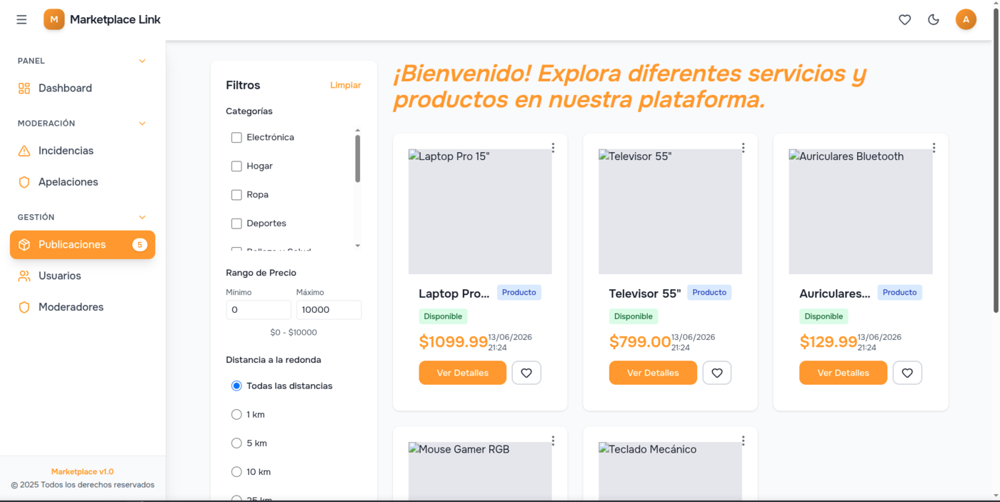
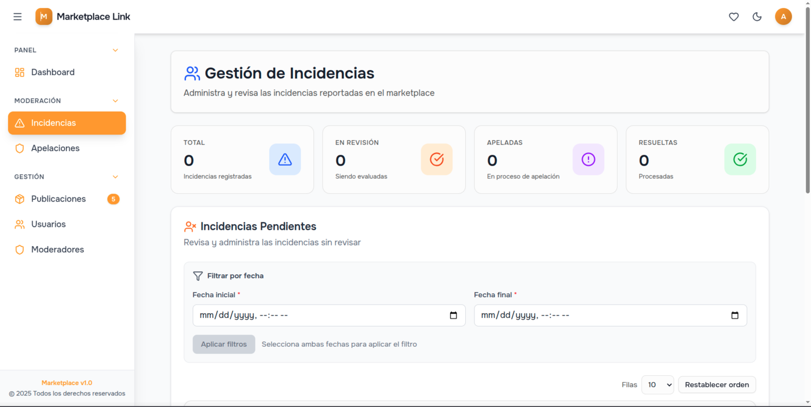

# Marketplace Link · Frontend

Aplicación web de Marketplace Link, un marketplace con geolocalización y moderación: los vendedores publican productos y servicios, los compradores los encuentran por categoría, precio y distancia, y los moderadores atienden incidencias y apelaciones. Consume la API de [Marketplace_Link](https://github.com/DavidJosueP2/Marketplace_Link).



## Pantallas

| Rol | Qué puede hacer |
|---|---|
| Visitante | Registrarse, verificar el correo, iniciar sesión y recuperar la contraseña |
| Comprador | Explorar el catálogo con filtros, ver el detalle, guardar favoritos y reportar publicaciones |
| Vendedor | Crear y editar publicaciones con imágenes, ver sus productos y apelar decisiones |
| Moderador | Revisar incidencias y apelaciones asignadas y decidir |
| Administrador | Gestionar usuarios y moderadores, ver el dashboard y los reportes |

El perfil incluye datos personales, cuenta, seguridad y la ubicación usada para filtrar por distancia (mapa con Leaflet).



## Stack

React 19 · TypeScript · Vite 7 · Tailwind CSS 4 · shadcn/ui (Radix) · TanStack Query y Table · React Hook Form · Leaflet · Recharts · Axios

Pruebas con Vitest y Testing Library, y end to end con Playwright. Se despliega como imagen Docker servida por Nginx, con un pipeline de Jenkins.

## Ejecutar en local

Requisitos: Node.js 20+ y el backend corriendo.

```bash
cp .env.example .env   # VITE_API_URL, VITE_AZURE_STORAGE_URL, límites de subida
npm install
npm run dev            # http://localhost:5174
```

Con Docker:

```bash
docker compose up --build   # http://localhost:5174 (FRONT_PORT)
```

| Variable | Uso |
|---|---|
| `VITE_API_URL` | URL de la API |
| `VITE_AZURE_STORAGE_URL` | URL pública de las imágenes (Azure Blob Storage o Azurite) |
| `VITE_FRONTEND_URL` | URL pública del frontend |
| `VITE_MAX_FILE_SIZE`, `VITE_MAX_FILES` | Límites de subida de imágenes |

## Pruebas

```bash
npm test                 # unitarias (Vitest)
npm run test:coverage    # con cobertura
npm run test:e2e         # Playwright: auth, publicaciones, favoritos, incidencias y usuarios
```
